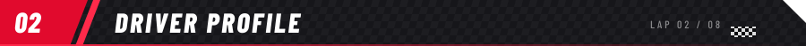
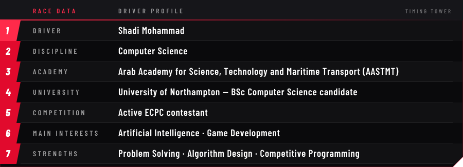
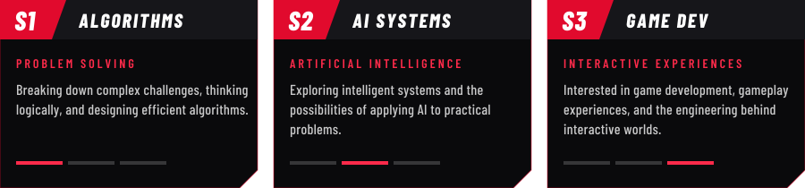
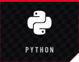
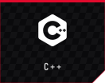
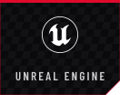
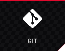
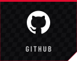

## Hi there 👋

<!--
  BEFORE YOU PUSH: find & replace these 3 placeholders
    YOUR_GITHUB_USERNAME  -> your GitHub username
    YOUR_LINKEDIN_URL     -> https://www.linkedin.com/in/your-handle
    YOUR_EMAIL            -> you@example.com
  Also make sure assets/racing-control-banner.svg exists in this repo.
-->

  

   

  

   

  
  
  

  
<em>🏎️ Driven by curiosity. Powered by code. Always chasing the next lap.</em>

Welcome to my developer profile — the digital version of my engineering garage.

🎓 I'm **Shadi Mohammad**, a Computer Science student at the **Arab Academy for Science, Technology and Maritime Transport (AASTMT)** and a **BSc Computer Science candidate at the University of Northampton**.

🤖 I'm an **Artificial Intelligence enthusiast** with a strong interest in **Game Development**, **competitive programming**, and the art of solving complex problems. I enjoy exploring how technology works under the hood, designing logical solutions, and turning ideas into working software.

🏁 My goal is to keep learning, keep building, and get a little better with every lap.

The banner's circuit is divided into three sectors. Each one represents a core part of my developer journey.

These are the areas I enjoy exploring and developing:

- 🤖 **Artificial Intelligence** — understanding and experimenting with intelligent technologies.
- 🎮 **Game Development** — exploring interactive systems and game creation.
- 🧠 **Data Structures & Algorithms** — building a strong foundation for efficient problem-solving.
- 🏁 **Competitive Programming** — practicing under constraints and improving analytical thinking.
- 💻 **Computer Science** — learning the principles behind reliable software and computational systems.

> **Garage rule:** Learn the fundamentals, test ideas, review the result, and come back stronger.

  &nbsp;&nbsp;&nbsp;&nbsp;&nbsp;

🏆 I'm an **active contestant in the Egyptian Collegiate Programming Contest (ECPC)**.

Competitive programming gives me a space to challenge my problem-solving skills, work with algorithmic ideas, and approach unfamiliar problems under time constraints.

**Current race objectives:**

- Improve algorithm design and implementation.
- Strengthen problem-solving speed and accuracy.
- Practice turning a problem statement into a clear, efficient solution.

*Every problem is another lap. Every accepted solution is progress.*

My GitHub is my development garage: a place to experiment, learn, and turn ideas into software.

I'm especially interested in projects around **Artificial Intelligence**, **Game Development**, and **problem-solving**. Visit my repositories to explore the work I have published and the experiments I'm developing.

  

  
  

   

  

   

  

Have an interesting idea, a project to build, or a problem worth solving? Feel free to connect.

  &nbsp;
  &nbsp;
  

  

  <h3>🏁 LIGHTS OUT. FULL THROTTLE.</h3>

  
<strong>“The next lap is always an opportunity to improve.”</strong>

  

